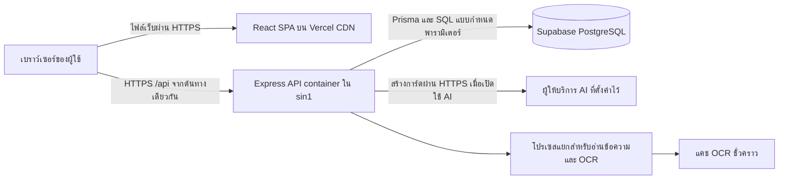
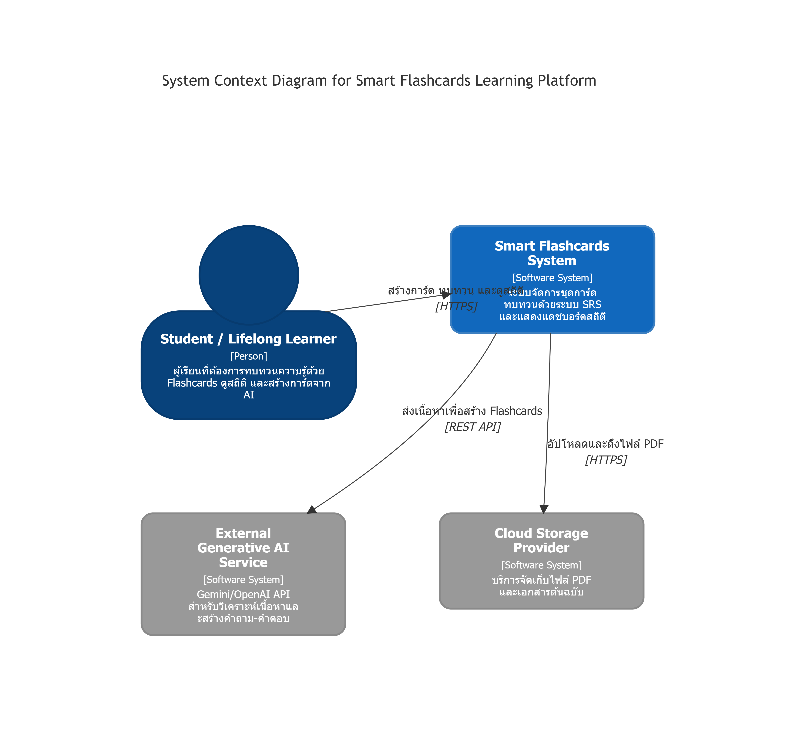
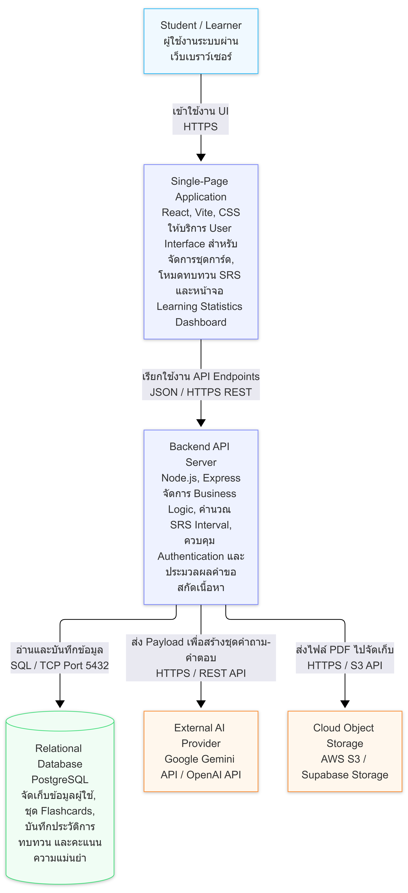

# สถาปัตยกรรมของ Focus Flashcards

เอกสารสถาปัตยกรรมและบันทึกการตัดสินใจของระบบปัจจุบัน ตรวจทานเมื่อ 2026-10-10

## ระบบที่ใช้งานปัจจุบัน

ระบบใช้ React/Vite เป็นส่วนแสดงผล และ Express API แบบ Modular Monolith โดยแยกฟีเจอร์เป็นโมดูลภายใน API เดียว ยืนยันตัวตนด้วย JWT ผ่าน cookie และใช้ Supabase PostgreSQL ร่วมกับ Prisma/pg การสร้างการ์ดด้วย AI ใช้ผู้ให้บริการที่รองรับ API แบบ OpenAI ตามค่าที่ตั้งไว้ ส่วนการเขียนเองและแยกข้อความใช้ได้โดยไม่ต้องมีคีย์ AI

Vercel เสิร์ฟไฟล์ส่วนแสดงผลจาก CDN และส่งคำขอ `/api` ไปยัง container ในสิงคโปร์ การรันด้วย Docker ปกติเป็นอีกทางเลือกหนึ่ง ดูรายละเอียดใน [เทคโนโลยีที่ใช้](tech_stack.md), [คู่มือพัฒนา](../development.md), [คู่มือ Vercel](../vercel.md), [คู่มือ Docker](../docker.md) และ [คู่มือผู้ใช้](../user_guide.md)

แผนภาพต่อไปนี้แสดงรูปแบบ deployment ปัจจุบัน ระบบยืนยันตัวตนและฟีเจอร์ธุรกิจยังอยู่ใน API เดียว การแยกส่วนเว็บกับ API ไม่ใช่การแยกแต่ละฟีเจอร์เป็น microservice

## แผนภาพ C4 ของข้อเสนอการออกแบบ

ภาพ PNG เดิมเก็บข้อเสนอการออกแบบไว้ การเชื่อม Gemini และบริการเก็บไฟล์บนคลาวด์ที่ปรากฏในภาพยังไม่ได้เป็นส่วนหนึ่งของระบบที่ใช้งานจริง ปัจจุบันไฟล์เอกสารต้นฉบับเก็บใน PostgreSQL และการแบ่งเส้นทางของ Vercel เป็นไปตามแผนภาพด้านบน จึงควรอ่านภาพเหล่านี้ร่วมกับ ADR เพื่อแยกส่วนที่เสนอไว้กับส่วนที่นำมาใช้แล้ว

### แผนภาพส่วนประกอบระดับ Container

## บันทึกการตัดสินใจทางสถาปัตยกรรม (ADR)

| หมายเลข                                           | สถานะ                                    | เรื่อง                                           |
| ------------------------------------------------- | ---------------------------------------- | ------------------------------------------------ |
| [0001](adr/0001-tech-stack-selection.md)          | ถูกแทนที่แล้ว                            | ข้อเสนอ Next.js/Firebase เดิม                    |
| [0002](adr/0002-implement-selected-tech-stack.md) | ยอมรับแล้ว โดยมี ADR ถัดมาขยายรายละเอียด | React/Vite, Express, JWT และการสร้างการ์ด        |
| [0003](adr/0003-modular-monolith.md)              | ยอมรับแล้ว โดยปรับ deployment ตาม 0009   | Modular Monolith; เปลี่ยนเลขจาก ADR 0001 ที่ซ้ำ  |
| [0008](adr/008-prisma-supabase.md)                | ยอมรับและใช้งานแล้ว                      | Prisma/pg และ Supabase PostgreSQL                |
| [0009](adr/0009-vercel-services.md)               | นำมาใช้แล้ว                              | ส่วนแสดงผลบน CDN, API container และการตรวจต้นทาง |
| [0010](adr/0010-shared-content-and-review.md)     | นำมาใช้แล้ว                              | ต้นฉบับร่วมกัน, SRS, การจัดเก็บ และประวัติ       |
| [0011](adr/0011-private-read-cache.md)            | นำมาใช้แล้ว                              | แคชข้อมูลอ่านชั่วคราวแยกตามบัญชี                 |

หมายเลข ADR ไม่ซ้ำกัน การเว้นหมายเลขไม่ได้หมายความว่ามีฟีเจอร์ที่ยังขาดเอกสาร แต่ละ ADR เก็บวันที่ตัดสินใจเดิมไว้ ส่วน [แบบจำลอง UML](uml_models.md) ยังเป็นแม่แบบ ไม่ใช่แผนภาพ UML ที่จัดทำเสร็จแล้ว
