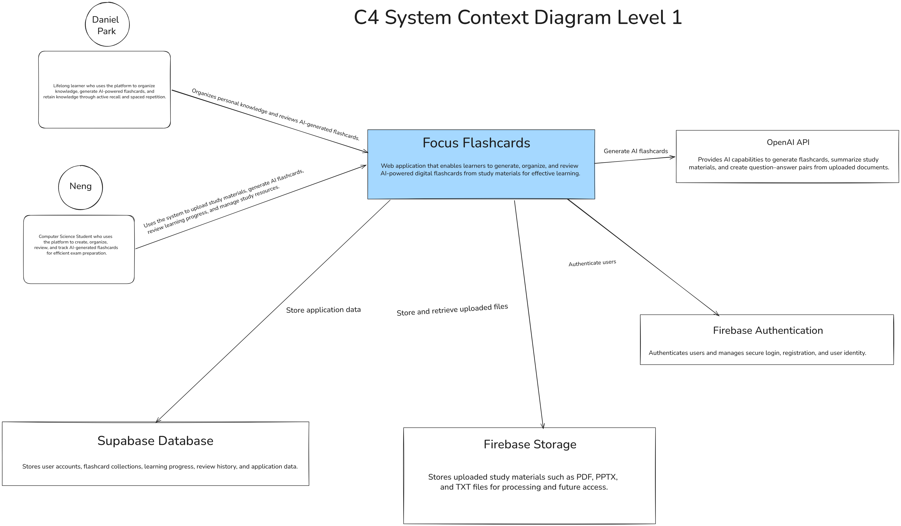
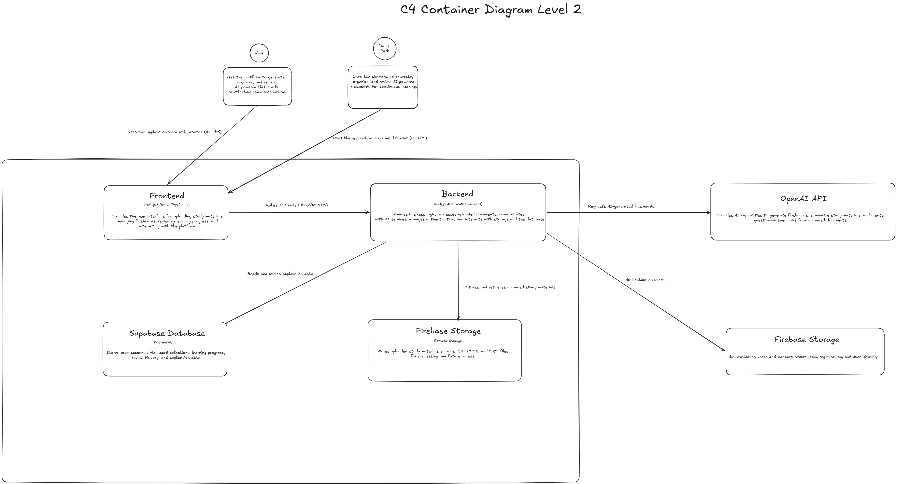

# Project Architecture

This directory contains key architectural diagrams and decision records for the project.

## Current implementation

The active application follows [tech_stack.md](tech_stack.md) and [ADR 0002](adr/0002-implement-selected-tech-stack.md): React/Vite, Express, PostgreSQL, JWT cookies and OpenAI. See [development instructions](../development.md).

The PNG diagrams below record the earlier Next.js/Firebase proposal. Use [current Mermaid context](c4-context.md) and [container diagram](c4-container.md) for the selected design; external object storage remains a planned extension.

## C4 Model: System Context (Level 1)

## C4 Model: Container (Level 2)

## Architectural Decision Records (ADRs)

- [ADR-001: Selection of Core Technology Stack](./adr/0001-tech-stack-selection.md)
