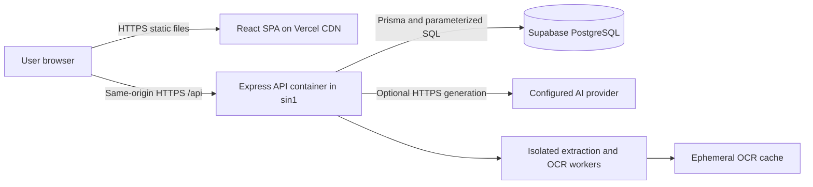

# Project Architecture

Current architecture and decision records for Focus Flashcards. Reviewed 2026-10-10.

## Current implementation

The active application uses React/Vite, one Express modular-monolith API, custom JWT cookies and Supabase PostgreSQL with Prisma/pg. AI generation uses the configured OpenAI-compatible provider; manual/local creation remains available without AI credentials.

Vercel serves static frontend files from its CDN and `/api` through a container in Singapore. The ordinary Docker build remains a separate deployment option. See [tech_stack.md](tech_stack.md), [development instructions](../development.md), [Vercel guide](../vercel.md), [Docker guide](../docker.md) and [user guide](../user_guide.md).

The following diagram describes the current deployment. Authentication and business features remain modules in the same API; the web/API split is not a microservice per feature.

## Planning C4 diagrams

These existing PNGs preserve the design proposal. Gemini and cloud object storage shown in them are not implemented dependencies. Original document bytes currently live in PostgreSQL, and Vercel routing is described above. Read the diagrams together with the ADRs rather than treating every proposed integration as deployed.

### Container diagram

## Architectural Decision Records (ADRs)

| Record                                            | Status                               | Subject                                      |
| ------------------------------------------------- | ------------------------------------ | -------------------------------------------- |
| [0001](adr/0001-tech-stack-selection.md)          | Superseded                           | Original Next.js/Firebase proposal           |
| [0002](adr/0002-implement-selected-tech-stack.md) | Accepted; refined by later records   | React/Vite, Express, JWT and generation      |
| [0003](adr/0003-modular-monolith.md)              | Accepted; deployment refined by 0009 | Modular monolith; former duplicate ADR 0001  |
| [0008](adr/008-prisma-supabase.md)                | Accepted and in use                  | Prisma/pg and Supabase PostgreSQL            |
| [0009](adr/0009-vercel-services.md)               | Implemented                          | Vercel CDN/container split and exact origins |
| [0010](adr/0010-shared-content-and-review.md)     | Implemented                          | Shared originals, SRS, archive and history   |
| [0011](adr/0011-private-read-cache.md)            | Implemented                          | Account-scoped temporary read cache          |

Record numbers are unique; gaps do not imply undocumented features. The original decision dates remain in their records. [uml_models.md](uml_models.md) is still a template and is not a completed UML model.
